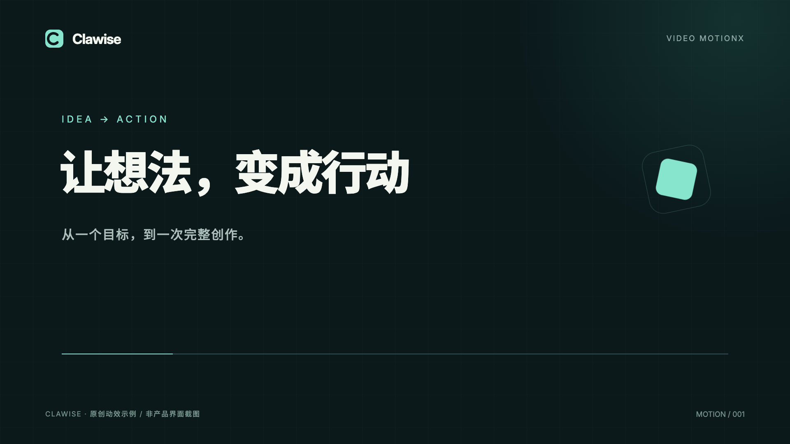

# Clawise Video MotionX

用一句话开始，用真实画面打磨。为 Clawise 制作的可编辑动效技能：本地预览、指点画面修改、确定性时间轴和视频导出。

[English](README.en.md) · [技能说明](skills/clawise-video-motionx/SKILL.md) · [下载 ZIP](https://github.com/zimuoo/clawise-video-motionx/releases/latest)



安装到 Clawise：

```sh
npx --yes github:zimuoo/clawise-video-motionx install
```

需要 Node.js 22+ 和 Git。命令直接读取这个 GitHub 仓库，包含完整技能、引擎、模板和字体，不需要另外安装其他人的运行包。默认安装到 `~/.clawise/skills/clawise-video-motionx`；安装后在 Clawise 刷新技能列表或开始新会话。

如果网络环境限制 GitHub 简写协议，可显式用 HTTPS：

```sh
npx --yes --package=git+https://github.com/zimuoo/clawise-video-motionx.git motionx install
```

自定义 Clawise state 目录：

```sh
npx --yes github:zimuoo/clawise-video-motionx install --state-dir "/path/to/clawise-state"
```

路径优先级为 `--state-dir` → `CLAWISE_STATE_DIR` → `OPENCLAW_STATE_DIR` → `~/.clawise`。安装器只管理其中的 `skills/clawise-video-motionx`，不改配置或其他技能。会拒绝覆盖本地修改或未接管的同名目录；用户保存备份后可明确加 `--force`。符号链接路径会被拒绝，请使用实际路径。

目前提供 GitHub 安装命令；npm registry 的短包名命令尚未发布。

更新和查看安装状态：

```sh
npx --yes github:zimuoo/clawise-video-motionx update
npx --yes github:zimuoo/clawise-video-motionx status
```

也可以从 Releases 下载 `clawise-video-motionx-1.0.0.zip`，在 Clawise 的技能导入中选择 ZIP。它与命令安装包含同一个完整技能，没有依赖仓库父目录的路径。

## 在 Clawise 里使用

例如直接说：

> 用 Clawise Video MotionX 为这个产品做一段 12 秒发布动画，用项目里的 logo 和真实 UI，给我可编辑工程、预览和 MP4。

> 第 5 秒的标题太小，放大一点，其他部分保持。

技能会选择方向、整理分镜、建立本地工程、检查真实关键帧，再导出。默认无平台水印；客户视频使用客户品牌。配音优先导入已有音频或接入 Clawise 中实际可用的语音能力，安装不会下载模型。

## 直接体验命令

预览和导出另需本机 Chrome/Chromium/Edge、FFmpeg 和 ffprobe。可用 `MOTIONX_CHROME` 指定浏览器文件。`doctor` 会列出缺失项。

```sh
npx --yes github:zimuoo/clawise-video-motionx doctor
npx --yes github:zimuoo/clawise-video-motionx demo ./my-clawise-film
```

`demo` 创建原创 Clawise 工程并启动本地工作台，终端保持运行。另开终端：

```sh
npx --yes github:zimuoo/clawise-video-motionx set title="我的下一次创作" ./my-clawise-film
npx --yes github:zimuoo/clawise-video-motionx check ./my-clawise-film
npx --yes github:zimuoo/clawise-video-motionx sound ./my-clawise-film
npx --yes github:zimuoo/clawise-video-motionx render ./my-clawise-film --workers 2
```

成片在工程的 `out/` 中，自动使用新版本文件名。工作台只在本机开放；生成分享页的命令不会自动发布或上传。

| 能力 | 命令 |
|---|---|
| 查看 12 套模板 / 新工程 | `templates` / `new ./film --template clawise-launch` |
| 本地预览 / 关键帧 | `studio ./film` / `still ./film --at 1,5,10` |
| 画面反馈与处理 | `inbox ./film` / `look <id> ./film` / `done <id> ./film --note "改动"` |
| 检查与导出验收 | `check ./film` / `render ./film` / `qa ./film` |
| 音频导入 / 本地配乐 | `voice ./film --audio ./voice.wav --text ./script.txt --asr off --fit` / `sound ./film` |
| 透明叠加 / GIF | `render ./film --transparent` / `render ./film --format gif` |
| 本地分享包 / 可编辑网页 | `share ./film` / `export html ./film` |

安装后也可直接运行 `node "<Clawise state>/skills/clawise-video-motionx/bin/motionx" <command>`，无需每次 npx。各命令参数见 `npx --yes github:zimuoo/clawise-video-motionx help-engine`。

## 运行与存储

- 工程：`index.html`、`assets/`、`vendor/`；工具历史与评论在 `.motionx/`，输出在 `out/`。
- 个人经验和可选缓存：`<Clawise state>/motionx/`；`MOTIONX_HOME` 可以单独指定。
- 所有模板使用本地字体与资源；新工程不会覆盖已有 `index.html`。
- MotionX Timeline 是独立实现的有限时间轴，保证随包模板和逐帧工作流；[支持范围](skills/clawise-video-motionx/references/timeline.md)不等同于其他动画库的完整 API。
- 可选 TTS/ASR 模型只在显式 `--allow-download` 时下载；详见[语音说明](skills/clawise-video-motionx/references/voice.md)。

## 开发与打包

```sh
git clone https://github.com/zimuoo/clawise-video-motionx.git
cd clawise-video-motionx
npm test
npm run pack:skill
npm pack
```

项目没有 npm 运行依赖。`pack:skill` 生成带校验清单的完整 ZIP，排除测试、历史、缓存和嵌套技能。GitHub Actions 验证安装、包移动、模板资源、时间轴和真实浏览器渲染。

[MIT](LICENSE)。字体与 three.js 保留各自授权，来源与改造边界见 [THIRD_PARTY_NOTICES.md](THIRD_PARTY_NOTICES.md)。产品界面和默认输出统一为 Clawise；法定版权声明完整保留。
